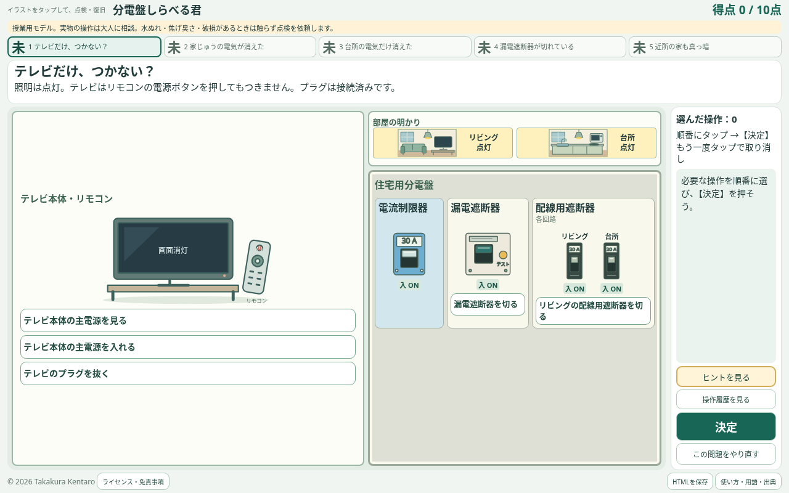

# 停電の原因、どこにある？｜分電盤しらべる君

家の電気がつかなくなったとき、分電盤のどこを見ればよいのでしょうか。
テレビだけなのか、台所だけなのか。それとも、近所も停電しているのか。

図を見ながら、原因と対応を考える「分電盤しらべる君」を作りました。

### こんなアプリ

部屋の明かりや家電、分電盤の状態を見て、必要な操作を順番に選びます。

- テレビだけ、つかない。
- 家じゅうの電気が消えた。
- 台所の電気だけ消えた。
- 漏電遮断機が切れている。
- 近所の家も真っ暗。

５つの場面で、停電の原因を切り分けていきます。

操作をする順にタップし、「決定」で答え合わせ。
正解の説明を閉じると、次のステージへ進みます。

ヒントなしで正解すると２点、ヒントを使うと１点。全５問で10点満点です。

### 図を見て、必要な対応を考える

「家全体が暗いときと、台所だけ暗いとき。何が違う？」
「ブレーカーを戻す前に、しておくことは？」

分電盤には、電流制限器、漏電遮断機、配線用遮断機を表示しました。
家電の消費電力や、近所の明かりも手がかりになります。

選択肢には、その場面では必要のない操作も含めています。

どこを見て、何を選ぶか。
操作しながら、分電盤の役割と安全な対応を考えてほしい。そんなねらいでつくっています。

### 学習指導要領との関連

> 保守点検の必要性について理解すること。

[中学校学習指導要領（平成29年告示）解説 技術・家庭編　Ｃ エネルギー変換の技術（1）アより一部抜粋](https://www.mext.go.jp/component/a_menu/education/micro_detail/__icsFiles/afieldfile/2019/03/18/1387018_009.pdf)

電気を安全に利用するために、機器の状態を確かめ、状況に合った対応を考える。
分電盤の働きや、保守点検の必要性を学ぶ場面での活用を想定しています。

※図や数値は授業用のモデルです。実際の設備では構成や操作方法が異なります。生徒だけで実物を操作せず、異常があるときは大人や専門家に相談してください。

### ダウンロードはこちら

👉[いますぐ使う](https://ken-tak-steam.github.io/bundenban_shiraberu_kun/)

⬇️[ダウンロード](https://ken-tak-steam.github.io/bundenban_shiraberu_kun/download.html)

🔗[GitHub](https://github.com/ken-tak-steam/bundenban_shiraberu_kun)

保存したHTMLファイルは、オフラインでも使えます。
利用条件は、アプリ内の「ライセンス・免責事項」をご確認ください。

#技術教育 #自作アプリ #エネルギー変換の技術 #分電盤 #電気 #GIGAスクール #ICT #STEAM #AI #バイブコーディング
